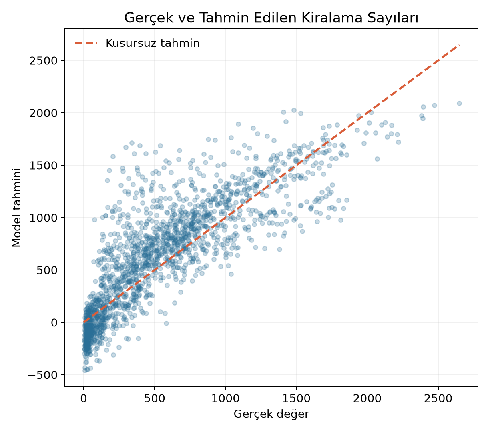

# Şehrin Nabzı - Bisiklet Talep Tahmini

<p align="center">
  <strong>Takvim ve hava koşullarından saatlik bisiklet kiralama talebi üreten uçtan uca Python projesi.</strong>
</p>

<p align="center">
  <a href="https://colab.research.google.com/github/serratanis/sehrin-nabzi-bisiklet-talep/blob/main/notebooks/Sehir_Nabzi_Bisiklet_Talep_Tahmini.ipynb"></a>
  
  
  
</p>

Şehrin Nabzı, Washington D.C. bisiklet paylaşım sisteminin saatlik talebini takvim ve hava koşullarından tahmin eder. Proje; veri toplama, temizleme, keşifçi analiz, modelleme, dürüst değerlendirme ve kullanıcı arayüzünü tek bir yeniden üretilebilir akışta birleştirir.



## Öne çıkan sonuç

- Veri dönemi: **2025**, toplam **8.760 saatlik gözlem**
- Kaynak hacim: Capital Bikeshare tarafından yayımlanan **6.662.611 yolculuk**
- Zaman sırası korunmuş test sonucu: **R² 0,578**, **MAE 234,3**
- Eğitim ortalaması baseline MAE: **476,8**
- Baseline'a göre hata azalması: **%50,9**

Model sonucu tek başına değil, baseline karşılaştırması ve hata grafikleriyle birlikte raporlanır.

## Hızlı başlangıç

### Mac'te arayüzü açma

`SEHRIN_NABZI_BASLAT.command` dosyasına çift tıklayın. Kapatmak için `SEHRIN_NABZI_DURDUR.command` dosyasını kullanın.

### Terminal ile çalıştırma

```bash
python3 -m venv .venv
source .venv/bin/activate
pip install -r requirements.txt
python -m streamlit run app.py
```

Model deneyini ve testleri yeniden çalıştırmak için:

```bash
python src/run_experiment.py
python -m pytest -q
```

İşlenmiş veri projede hazırdır. Ham kaynaklardan yeniden üretmek için internet bağlantısıyla `python src/prepare_dataset.py --download` komutunu kullanabilirsiniz.

## Proje çıktıları

- [Colab çalışma defteri](https://colab.research.google.com/github/serratanis/sehrin-nabzi-bisiklet-talep/blob/main/notebooks/Sehir_Nabzi_Bisiklet_Talep_Tahmini.ipynb)
- `reports/Sehir-Nabzi-Proje-Raporu-Gelistirilmis-v2.docx`: geliştirilmiş proje raporu
- `presentation/Sehir-Nabzi-Sunum-Gelistirilmis-v2.pptx`: kapak tasarımlı beş slaytlık sunum
- `MODEL_CARD.md`: kullanım sınırları ve model değerlendirmesi
- `QUALITY_AUDIT.md`: veri ve kalite kontrolleri

## Proje yapısı

```text
app.py          Streamlit tahmin paneli
data/processed  2025 saatlik model verisi
src/            Veri hazırlama ve modelleme kodları
notebooks/      Colab uyumlu çalışma defteri
assets/         Grafikler, metrikler ve eğitilmiş model
reports/        Proje raporu
presentation/   Beş slaytlık sunum
tests/          Otomatik testler
```

## Veri kaynakları ve sınırlar

- [Capital Bikeshare System Data](https://capitalbikeshare.com/system-data)
- [Capital Bikeshare Data License Agreement](https://capitalbikeshare.com/data-license-agreement)
- [Open-Meteo Historical Weather API](https://open-meteo.com/en/docs/historical-weather-api)

Ham yolculuk dosyaları lisans koşulları nedeniyle yeniden dağıtılmaz. Model, 2025 Washington D.C. örüntülerini öğrenir; farklı şehir veya dönemlerde yeniden doğrulanmadan operasyonel karar aracı olarak kullanılmamalıdır.
